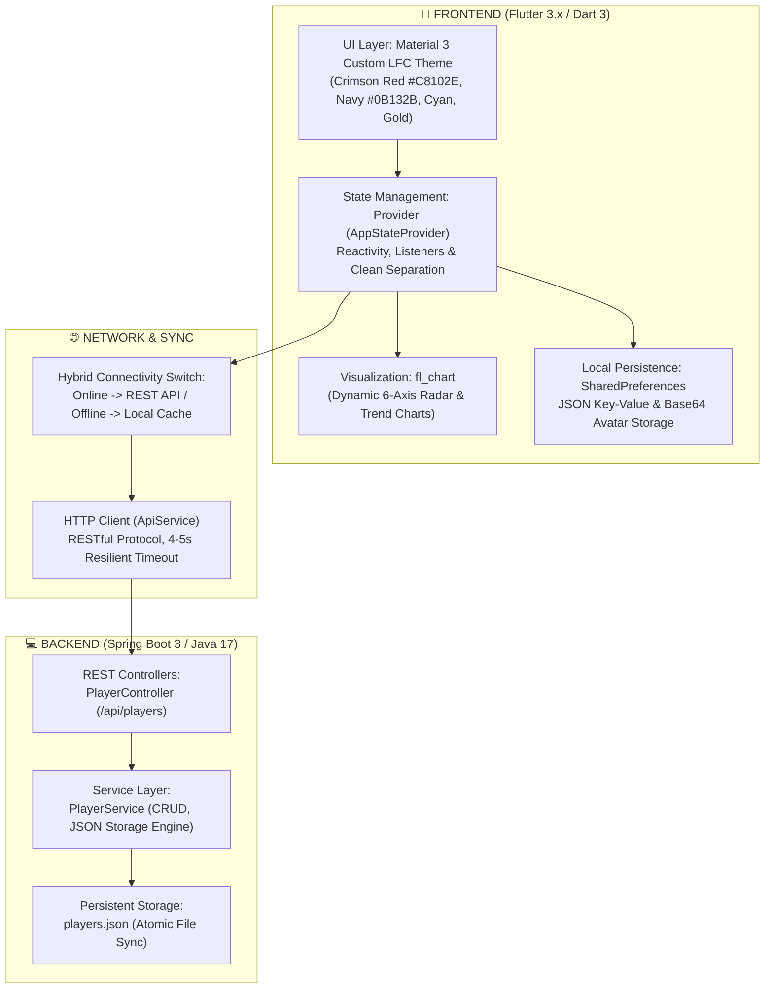
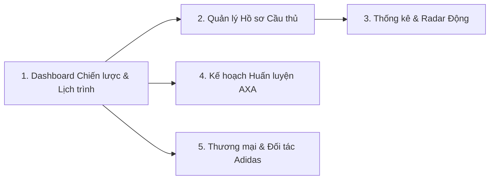

# 🔴 TÀI LIỆU TOÀN DIỆN: THUYẾT TRÌNH BẢO VỆ DỰ ÁN PRM392
# LIVERPOOL PLAYER MANAGEMENT & COMMERCIAL SYSTEM (LFC PMS)
### *Hệ thống Quản lý Cầu thủ & Khai thác Thương mại Toàn diện - Mùa giải 2026/2027*

---

## MỤC LỤC
1. [Tổng quan Đề tài & Bối cảnh (Concept & Project Overview)](#1-tổng-quan-đề-tài--bối-cảnh)
2. [Kiến trúc Kỹ thuật & Tech Stack (Technical Architecture)](#2-kiến-trúc-kỹ-thuật--tech-stack)
3. [Điểm sáng Tạo & Ý nghĩa Đồ án (Core Values & Highlights)](#3-điểm-sáng-tạo--ý-nghĩa-đồ-án)
4. [Phân tích Chi tiết 5 Module Chính & Cách Thức Code](#4-phân-tích-chi-tiết-5-module-chính--cách-thức-code)
5. [Kịch bản Thuyết trình & Live Demo Từng Phút (Presentation Script)](#5-kịch-bản-thuyết-trình--live-demo-từng-phút)
6. [Bộ Câu hỏi Phản biện Tiềm năng từ Giảng viên & Câu Trả lời Chuẩn (Q&A Defense)](#6-bộ-câu-hỏi-phản-biện-tiềm-năng--câu-trả-lời-chuẩn)

---

## 1. TỔNG QUAN ĐỀ TÀI & BỐI CẢNH

### 1.1. Đặt vấn đề
Trong bóng đá hiện đại, một câu lạc bộ hàng đầu thế giới như **Liverpool FC** không chỉ quản trị cầu thủ đơn thuần trên sân cỏ mà phải vận hành như một doanh nghiệp thể thao đa quốc gia với giá trị đội hình vượt mốc **€1.2 Tỷ**. Ban lãnh đạo, Giám đốc Thể thao và Ban Huấn luyện cần đối mặt với 3 bài toán lớn:
1. **Quản trị Chuyên môn & Y tế**: Nắm bắt thể lực, chỉ số chuyên môn, nguy cơ chấn thương và tiến độ phát triển của từng cầu thủ theo thời gian thực.
2. **Kế hoạch Tập huấn AXA**: Quản lý lịch huấn luyện dày đặc tại trung tâm huấn luyện AXA Training Centre, phân công bài tập và theo dõi mức độ hoàn thành giáo án.
3. **Khai thác Giá trị Thương mại & Tài trợ (Sponsorship - Trọng tâm Adidas)**: Cầu thủ là tài sản thương hiệu lớn. Việc theo dõi giá trị thị trường, các chiến dịch quảng bá với đối tác trang phục thể thao chính thức (Adidas) và tư liệu Media/PR là yếu tố sống còn cho doanh thu câu lạc bộ.

### 1.2. Mục tiêu Dự án
Xây dựng ứng dụng di động **Liverpool Player Management & Commercial System** cung cấp một giải pháp quản trị số khép kín (All-in-one Management Platform) phục vụ cho Ban Lãnh đạo Liverpool FC:
* Quản lý hồ sơ chi tiết 25 cầu thủ đội 1 (Season 2026/2027).
* Theo dõi năng lực và sự tiến bộ qua biểu đồ Radar Chart động và Line Chart phát triển.
* Quản lý lịch trình tập luyện AXA và tự động cộng chỉ số thể lực khi hoàn thành bài tập.
* Quản lý media, hình ảnh, video phỏng vấn và chiến dịch thương mại Adidas.
* Khả năng chạy Hybrid mượt mà: Hoạt động với Backend Spring Boot và tự động Fallback Offline khi mất mạng.

---

## 2. KIẾN TRÚC KỸ THUẬT & TECH STACK

### 2.1. Frontend Stack (Mobile App)
* **Framework**: Flutter SDK (Dart 3), thiết kế Responsive hoạt động trên Android, iOS, Web và Desktop.
* **Architecture Pattern**: Provider Pattern kết hợp MVVM (Model - View - ViewModel/Provider):
  * `models/`: `Player`, `TrainingSession`, `SponsorCampaign`, `PlayerMediaItem`.
  * `providers/`: `AppStateProvider` đóng vai trò Single Source of Truth cho toàn bộ ứng dụng.
  * `screens/`: Tách biệt 5 module độc lập.
  * `widgets/`: Tái sử dụng cao (`PlayerAvatar`, `PlayerCardItem`, `DeletePlayerDialog`).
* **Visual Components**: Thư viện `fl_chart` cho biểu đồ Radar & Line Chart; `cached_network_image` cho bộ đệm hình ảnh; `google_fonts` và icon phong cách Premier League.

### 2.2. Backend Stack (Server REST API)
* **Framework**: Spring Boot 3.3.x (Java 17).
* **Storage Engine**: `Jackson ObjectMapper` lưu trữ JSON cấu trúc phẳng (`players.json`), đảm bảo nhẹ, dễ đọc, không phụ thuộc cài đặt phức tạp, chạy ngay lập tức.
* **API Endpoints**:
  * `GET /api/players`: Trả về toàn bộ danh sách 25 cầu thủ và hình ảnh.
  * `GET /api/players/{id}`: Xem chi tiết cầu thủ.
  * `PUT /api/players/{id}`: Cập nhật thông tin, đổi avatar Base64, sửa chỉ số, thêm video PR.
  * `POST /api/players`: Thêm cầu thủ mới hoặc phục hồi sau khi Undo.
  * `DELETE /api/players/{id}`: Xóa cầu thủ khỏi hệ thống.
  * `POST /api/players/reset`: Khôi phục toàn bộ danh sách mặc định ban đầu.
* **CORS Support**: `@CrossOrigin(origins = "*")` mở quyền cho thiết bị Android Emulator (`10.0.2.2:8080`), Web localhost và thiết bị thật.

### 2.3. Cơ chế Lưu trữ & Bảo toàn Ảnh Vĩnh viễn (Base64 Encoding)
> [!IMPORTANT]
> **Điểm mấu chốt chống lỗi khi chuyển máy**: Khi đổi ảnh từ máy tính thông qua `ImagePicker`, nếu dùng đường dẫn file cục bộ (`C:\Users\...`) thì khi đem project sang máy thầy/cô hoặc bạn khác sẽ lập tức bị lỗi `File Not Found`.
> **Giải pháp của nhóm**: Toàn bộ ảnh tải lên được app đọc byte và mã hóa thành **Base64 Data URI** (`data:image/jpeg;base64,...`) lưu trực tiếp vào JSON. Dữ liệu ảnh nằm ngay trong file JSON và SharedPreferences. Khi copy project sang bất kỳ máy nào, ảnh hiển thị 100% không bao giờ mất.

---

## 3. ĐIỂM SÁNG TẠO & Ý NGHĨA ĐỒ ÁN

1. **Biểu đồ Radar Linh hoạt theo Vị trí (Dynamic Attribute System)**:
   * Không dùng chung 1 bộ chỉ số cố định. Hệ thống tự động thay đổi 6 trục đánh giá theo vị trí thực tế của cầu thủ:
     * *Forward*: Pace, Shooting, Passing, Dribbling, Positioning, Physical.
     * *Midfielder*: Passing, Vision, Dribbling, Ball Control, Defending, Stamina.
     * *Defender*: Tackling, Interception, Heading, Positioning, Strength, Passing.
     * *Goalkeeper*: Reflexes, Diving, Handling, Positioning, Kicking, One-on-one.
2. **Theo dõi Tiến độ & Tương tác Chỉ số Thời gian thực**:
   * Biểu đồ tiến độ từ Tháng 1 đến Tháng 4 với Checkbox cho phép người dùng bật/tắt chỉ số muốn xem.
   * Thanh trượt (Slider) trong giao diện cho phép ban huấn luyện tinh chỉnh trực tiếp chỉ số cầu thủ sau mỗi buổi tập, Radar Chart phản hồi tức thì.
3. **Cơ chế Hoàn tác Xóa (Delete with Undo & Confirmation Dialog)**:
   * Xóa cầu thủ có hộp thoại xác nhận thẩm mỹ cao mang màu sắc Liverpool FC.
   * Kèm Floating SnackBar trong 4 giây có nút **HOÀN TÁC** phục hồi cầu thủ ngay lập tức về đúng vị trí cũ.
4. **Liên kết Logic giữa Huấn luyện & Thể lực (Training Impacts Performance)**:
   * Khi ban huấn luyện bấm **"Hoàn thành giáo án"** tại màn hình Training, hệ thống tự động cộng `+0.5` điểm thể lực (Stamina) cho tất cả cầu thủ được phân công.
5. **Dashboard Điều hành 2 Chế độ (Dual-View Switcher)**:
   * Chuyển đổi 1 chạm giữa Dashboard Chiến lược (chỉ số sẵn sàng, ma trận chiều sâu 4 tuyến, Top tài sản thương mại) và Dashboard Lịch trình (chọn ngày xem lịch tập AXA và cảnh báo hợp đồng).

---

## 4. PHÂN TÍCH CHI TIẾT 5 MODULE CHÍNH & CÁCH THỨC CODE

### Module 1: Dashboard Điều hành Chiến lược (Command Dashboard)
* **Mục đích**: Cung cấp bức tranh toàn cảnh 360 độ về đội bóng cho Giám đốc Điều hành chỉ trong 1 màn hình.
* **Thành phần chức năng**:
  * **Chế độ 1 - Tổng quan Chiến lược**:
    * Chỉ số sẵn sàng (Squad Readiness): Cầu thủ Sung mãn (Active), Chấn thương (Injured), Nghi ngờ/Làm nhiệm vụ tuyển (Doubtful).
    * Ma trận chiều sâu 4 tuyến (Position Depth Matrix): Tỷ lệ phân bổ và định giá tiền nong (€M) của Tiền đạo, Tiền vệ, Hậu vệ, Thủ môn.
    * Tiêu điểm Cầu thủ Đắt giá nhất (Top Asset Spotlight): Hiển thị cầu thủ có giá trị thị trường lớn nhất (Florian Wirtz €135M).
    * Danh sách đội hình cuộn ngang (Horizontal Squad Carousel) giúp lướt nhanh toàn đội.
    * Nút Live Realtime Sync kết nối cập nhật dữ liệu.
  * **Chế độ 2 - Lịch trình & Đội hình theo ngày**:
    * Chọn ngày bất kỳ (Date Picker) để xem các buổi tập diễn ra trong ngày đó.
    * Danh sách cầu thủ sắp hết hạn hợp đồng cần gia hạn (Contract Expiry Alerts).

### Module 2: Quản lý Hồ sơ Cầu thủ (Squad & Player Management)
* **Mục đích**: Quản lý toàn bộ 25 cầu thủ chính thức của Liverpool FC mùa 2026/2027.
* **Cách code & Xử lý**:
  * `player_list_screen.dart`: Sử dụng `ListView.builder` kết hợp thanh tìm kiếm Search Bar lọc theo tên, quốc tịch, số áo và bộ lọc ngang `ChoiceChip` theo 4 vị trí.
  * Hỗ trợ thao tác vuốt xóa `Dismissible` kèm hộp thoại `DeletePlayerDialog`.
  * `player_detail_screen.dart`: Hiển thị Header cầu thủ, thông số hợp đồng, tình trạng y tế, chân thuận.
  * Hộp thoại chỉnh sửa thông tin toàn diện: Sửa số áo, giá thị trường, đổi vị trí, đổi tình trạng chấn thương.
  * Hộp thoại đổi Avatar: Cho phép chọn ảnh từ máy tính (tự encode Base64) hoặc chọn các ảnh chân dung mẫu có sẵn.

### Module 3: Thống kê Radar Động & Theo dõi Sự Tiến bộ (Player Statistics & Progress)
* **Mục đích**: Phân tích kỹ thuật chuyên sâu và ghi nhận sự phát triển qua từng tháng.
* **Cách code & Xử lý**:
  * `player_stats_screen.dart`: Sử dụng `RadarChart` từ `fl_chart`. Trục chỉ số được tính toán động thông qua hàm `player.attributes`.
  * Tích hợp thanh kéo Slider cho phép huấn luyện viên tinh chỉnh chỉ số từ 0 đến 99, biểu đồ Radar co giãn mượt mà theo thời gian thực.
  * Biểu đồ đường `LineChart` biểu diễn phong độ từ Tháng 1 đến Tháng 4: Người quản lý có thể tích chọn xem riêng lẻ tốc độ, dứt điểm hoặc chuyền bóng.

### Module 4: Lịch Huấn luyện & Quản lý Thể lực AXA (Training & Schedule)
* **Mục đích**: Tổ chức lịch trình huấn luyện của đội bóng tại trung tâm AXA Training Centre.
* **Cách code & Xử lý**:
  * `training_schedule_data.dart`: Tích hợp sẵn cơ sở dữ liệu lịch tập 2 tháng (Tháng 10 & Tháng 11/2026).
  * `training_schedule_screen.dart`:
    * Lịch hiển thị dạng lưới Calendar 7 cột, mỗi ngày có số hiển thị số lượng bài tập tương ứng hoặc dấu gạch ngang (ngày nghỉ).
    * Bộ lọc theo chuyên đề (`Tactical`, `Gym`, `Recovery`, `Match Prep`) và lọc theo cầu thủ tham gia.
    * Nút **"Lên lịch tập mới"**: Mở modal chọn thời gian bắt đầu, kết thúc, sân tập, huấn luyện viên phụ trách và tích chọn danh sách cầu thủ phân công.
    * Nút **"Hoàn thành (+0.5 Stamina)"**: Bấm hoàn thành sẽ đổi trạng thái buổi tập sang màu xanh `Completed` và kích hoạt hàm tăng thể lực cho cầu thủ trong `AppStateProvider`.

### Module 5: Quản trị Thương mại & Đối tác Adidas (Commercial & Sponsor Management)
* **Mục đích**: Quản trị tài chính và khai thác hình ảnh thương mại của CLB cùng đối tác trang phục thể thao chính thức Adidas.
* **Cách code & Xử lý**:
  * `commercial_screen.dart`:
    * Tổng giá trị đội hình: **€1.205 Tỷ**, biểu đồ tăng trưởng giá trị qua các tháng (+7.59%).
    * Quản lý hợp đồng đối tác Adidas: Thời hạn, trạng thái Active, giá trị tài trợ.
    * 5 chiến dịch quảng bá chính thức (Training Kit, Matchday Hero, F50 Speed of Light, Anfield Legends, Digital Global Reach) với số liệu tiếp cận (Reach) và tỷ lệ tương tác (Engagement %).
    * Modal tạo chiến dịch tài trợ mới và bổ sung tư liệu PR (ảnh, video YouTube highlight).

---

## 5. KỊCH BẢN THUYẾT TRÌNH & LIVE DEMO TỪNG PHÚT

> [!TIP]
> **Thời lượng đề xuất: 10 - 12 phút**. Hãy phân công 2 - 3 bạn trong nhóm lần lượt phụ trách các phần dưới đây để bài thuyết trình liền mạch và tự tin nhất.

### ⏱️ Phút 0:00 – 1:30 | Mở đầu & Bối cảnh (Người 1)
* "Kính chào Thầy/Cô và các bạn, hôm nay nhóm chúng em xin được đại diện nhóm trình bày đồ án môn Lập trình Di động (PRM392) với đề tài: **Liverpool Player Management & Commercial System**."
* "Trong bóng đá hiện đại, một CLB như Liverpool không chỉ quản lý cầu thủ trên sân mà còn là một bộ máy vận hành thương mại khổng lồ trị giá hơn 1 tỷ Euro. Vì vậy, nhóm chúng em đặt mục tiêu không chỉ làm một app CRUD đơn thuần, mà xây dựng một **Hệ sinh thái số khép kín** kết nối 3 trụ cột: **Chuyên môn cầu thủ - Kế hoạch huấn luyện thể lực - Khai thác thương mại đối tác Adidas**."

### ⏱️ Phút 1:30 – 3:00 | Kiến trúc Tech Stack & Điểm nhấn Kỹ thuật (Người 1 hoặc Người 2)
* "Về mặt công nghệ, hệ thống được xây dựng theo mô hình **Client-Server Full-Stack**:
  * **Frontend**: Viết bằng Flutter, tuân thủ Material Design 3 với bảng màu đặc trưng của Liverpool FC. Sử dụng **Provider Pattern** để quản lý trạng thái tập trung và phản hồi tức thì.
  * **Backend**: Xây dựng bằng **Spring Boot (Java 17)** cung cấp các chuẩn REST API CRUD đồng bộ.
  * **Cơ chế lưu trữ đặc biệt**: Để giải quyết triệt để vấn đề mất ảnh khi chuyển app sang máy khác, nhóm em áp dụng cơ chế **mã hóa Base64 Data URI**. Ảnh được lưu trực tiếp trong file JSON dữ liệu nên khi chạy trên bất kỳ máy nào, ảnh đại diện của cầu thủ luôn luôn hiển thị trọn vẹn.
  * Ngoài ra, ứng dụng có cơ chế **Dual Fallback**: Nếu bật Backend Spring Boot, app sẽ tự động đồng bộ thời gian thực; nếu tắt server, app vẫn hoạt động offline mượt mà nhờ SharedPreferences."

### ⏱️ Phút 3:00 – 8:30 | LIVE DEMO TRỰC TIẾP TRÊN MÀN HÌNH (Rất quan trọng)
*(Người trình bày cầm máy/chuột thao tác trực tiếp trên màn hình theo từng bước sau)*:

1. **Demo Dashboard (2 chế độ)**:
   * "Đầu tiên là màn hình Dashboard. Thầy/Cô có thể thấy bảng điều khiển trực quan với chỉ số sẵn sàng thi đấu: 23 cầu thủ khỏe mạnh, 1 chấn thương.
   * Bên dưới là **Ma trận chiều sâu 4 tuyến** phân tích tỷ trọng giá trị giữa Hàng công, Tiền vệ, Hàng thủ và Thủ môn.
   * Nhóm em tích hợp nút gạt **Dual-View Switcher** ngay trên đầu: Chỉ cần 1 chạm, màn hình chuyển sang chế độ **Lịch trình & Đội hình theo ngày**. Em có thể chọn ngày trên lịch để xem ngay các buổi tập AXA diễn ra trong ngày đó."
2. **Demo Danh sách Cầu thủ & Tính năng Xóa có Hoàn tác**:
   * "Chuyển sang tab **Squad**, đây là danh sách 25 cầu thủ của đội 1 mùa giải 2026/2027. Em có thể tìm kiếm theo tên hoặc lọc theo vị trí bằng các thẻ chip.
   * **Thử nghiệm tính năng Xóa**: Em vuốt cầu thủ sang trái hoặc bấm icon Thùng rác. Hộp thoại xác nhận màu đỏ Liverpool hiện lên. Khi em bấm Xóa, một thông báo hiện ra trong 4 giây kèm nút **HOÀN TÁC**. Em bấm Hoàn tác, cầu thủ lập tức được khôi phục về đúng vị trí cũ và đồng bộ lên server!"
3. **Demo Màn hình Chi tiết, Đổi Ảnh Base64 & Chỉnh sửa Hồ sơ**:
   * "Bấm vào cầu thủ **Florian Wirtz**. Ở đây có đầy đủ thông tin hợp đồng, vị trí, chân thuận.
   * Em bấm vào avatar để đổi ảnh: Em có thể chọn ảnh từ thiết bị hoặc chọn ảnh mẫu. Ngay lập tức ảnh đại diện được cập nhật và lưu vĩnh viễn.
   * Phía dưới là khu vực tư liệu Media/PR gồm các ảnh chụp và video highlight có thể bấm để mở link YouTube."
4. **Demo Radar Chart Động & Kéo Slider Chỉ số (Điểm nhấn sáng tạo nhất)**:
   * "Tiếp theo là màn hình **Statistics & Development**.
   * Thầy/Cô có thể thấy biểu đồ **Radar Chart 6 trục**. Điểm đặc biệt của nhóm em là **bộ chỉ số tự động thay đổi theo vị trí**: Cầu thủ tấn công sẽ có Pace, Shooting; còn nếu đổi sang Thủ môn Alisson hay Mamardashvili, biểu đồ sẽ đổi sang Reflexes, Diving, Handling.
   * Huấn luyện viên có thể kéo thanh trượt Slider để cập nhật trực tiếp chỉ số sau trận đấu, biểu đồ Radar co giãn tức thì.
   * Phía dưới là biểu đồ đường theo dõi tiến độ từ Tháng 1 đến Tháng 4, có các Checkbox bật/tắt từng chỉ số."
5. **Demo Lịch Tập AXA & Hoàn thành Giáo án tăng Thể lực**:
   * "Sang tab **Training & Schedule**: Đây là lịch trình tập huấn 2 tháng tại AXA Training Ground với chế độ xem lịch và dấu chấm thể hiện số buổi tập.
   * Em có thể bấm **Tạo buổi tập mới** cho ngày được chọn và phân công danh sách cầu thủ tham gia.
   * Đặc biệt, trên mỗi buổi tập có nút **'Hoàn thành (+0.5 Stamina)'**: Khi ban huấn luyện bấm nút này, buổi tập chuyển sang màu xanh và hệ thống tự động tăng điểm thể lực cho toàn bộ cầu thủ tham gia buổi tập đó."
6. **Demo Quản trị Thương mại Adidas**:
   * "Cuối cùng là tab **Commercial**: Quản lý tổng giá trị đội hình €1.2B và hợp đồng hợp tác chiến lược với **Adidas**.
   * Hệ thống hiển thị 5 chiến dịch tiêu biểu kèm số liệu người tiếp cận (Reach) và tỷ lệ tương tác (Engagement), chứng minh giá trị kinh tế của cầu thủ."

### ⏱️ Phút 8:30 – 10:00 | Kết luận & Định hướng Tương lai (Người 1)
* "Tóm lại, dự án **Liverpool Player Management & Commercial System** của nhóm đã hoàn thành xuất sắc các yêu cầu đề ra: Giao diện trực quan hiện đại, kiến trúc code module hóa rõ ràng, kết nối Backend Spring Boot ổn định và sở hữu các tính năng nghiệp vụ sâu sắc vượt trội hơn các ứng dụng CRUD thông thường.
* Trong tương lai, nhóm có thể mở rộng tích hợp phân tích dữ liệu AI dự đoán nguy cơ chấn thương và tích hợp cổng thanh toán bán áo đấu thương mại điện tử.
* Nhóm em xin chân thành cảm ơn Thầy/Cô và các bạn đã chú ý lắng nghe. Nhóm em rất mong nhận được câu hỏi và góp ý từ Thầy/Cô!"

---

## 6. BỘ CÂU HỎI PHẢN BIỆN TIỀM NĂNG & CÂU TRẢ LỜI CHUẨN

### ❓ Câu 1: Tại sao nhóm không dùng SQLite mà lại dùng SharedPreferences và Spring Boot JSON Backend?
> **Trả lời**:  
> "Dạ thưa Thầy/Cô, việc lựa chọn công nghệ dựa trên bài toán thực tế của nhóm:
> 1. Nhóm xây dựng theo mô hình **Client - Server chuyên nghiệp**, nơi dữ liệu cần được quản lý tập trung trên Backend Spring Boot để nhiều thiết bị của Ban huấn luyện có thể cùng truy cập và đồng bộ thời gian thực qua REST API.
> 2. Ở phía Client, `SharedPreferences` kết hợp JSON String được sử dụng làm **Local Cache thông minh**, giúp ứng dụng khởi động tức thì trong 0.1 giây và hỗ trợ cơ chế **Offline Fallback** hoàn hảo khi mất mạng mà không bị xung đột schema bảng phức tạp như SQLite.
> 3. Ngoài ra, việc lưu trữ JSON phẳng trên Backend giúp nhóm dễ dàng bảo toàn chuỗi mã hóa ảnh Base64 và hỗ trợ tính năng Export/Import mã sao lưu Backup chỉ bằng 1 thao tác."

### ❓ Câu 2: Làm thế nào để đảm bảo ảnh đại diện của cầu thủ không bị lỗi khi chuyển sang máy chấm của Giảng viên?
> **Trả lời**:  
> "Dạ, đây là vấn đề nhóm đã lường trước và xử lý triệt để:
> * Nếu lưu đường dẫn file cục bộ (ví dụ: `C:\Users\Admin\Pictures\photo.jpg`), khi sang máy của Thầy/Cô đường dẫn này chắc chắn không tồn tại và sẽ gây crash ảnh.
> * Nhóm em đã giải quyết bằng cách: Khi người dùng chọn bất kỳ bức ảnh nào từ thiết bị, Flutter sẽ đọc các byte nhị phân và mã hóa thành **chuỗi Base64 Data URI** (`data:image/jpeg;base64,...`). Chuỗi này được lưu trực tiếp vào JSON của cầu thủ.
> * Khi Thầy/Cô mở app trên máy mới, widget `PlayerAvatar` của nhóm kiểm tra nếu là Base64 sẽ dùng `Image.memory` giải mã trực tiếp từ RAM, không cần bất kỳ file ảnh vật lý nào trên ổ đĩa. Do đó ảnh được bảo toàn 100% trên mọi hệ điều hành (Windows, Mac, Android, iOS)."

### ❓ Câu 3: Quản lý trạng thái (State Management) trong dự án được tổ chức như thế nào? Tại sao lại chọn Provider?
> **Trả lời**:  
> "Dạ thưa Thầy/Cô, nhóm sử dụng thư viện **Provider** với lớp `AppStateProvider` kế thừa từ `ChangeNotifier`:
> * `AppStateProvider` đóng vai trò là **Single Source of Truth** (nguồn chân lý duy nhất). Tất cả các màn hình (Dashboard, Squad, Detail, Training, Commercial) đều lắng nghe dữ liệu từ Provider này.
> * Khi một hành động xảy ra (ví dụ: Huấn luyện viên bấm Hoàn thành buổi tập AXA $\rightarrow$ tăng 0.5 Stamina $\rightarrow$ gọi `notifyListeners()`), cả màn hình Detail, màn hình Radar Chart và màn hình Dashboard đều tự động cập nhật lại chỉ số mới mà không cần phải reload hay truyền dữ liệu thủ công qua từng Widget con.
> * Provider được nhóm lựa chọn vì nó là thư viện chính thức được Google khuyến nghị cho các dự án Flutter tầm trung, cú pháp trong sáng, hiệu năng cao và phân tách rõ ràng giữa tầng Logic và tầng Giao diện."

### ❓ Câu 4: Tính năng Radar Chart động theo vị trí hoạt động như thế nào về mặt code?
> **Trả lời**:  
> "Dạ, trong Model `Player`, nhóm em thiết kế một getter thông minh `attributes`:
> * Getter này sẽ kiểm tra `enum PlayerPosition`. Nếu là `forward`, nó sẽ trích xuất 6 trường đại diện cho tiền đạo (Pace, Shooting, Passing, Dribbling, Positioning, Physical). Nếu là `goalkeeper`, nó tự động ánh xạ sang (Reflexes, Diving, Handling, Positioning, Kicking, One-on-one).
> * Màn hình `player_stats_screen.dart` chỉ cần duyệt qua Map thuộc tính này để vẽ các trục của `RadarChartData`. Nhờ đó, giao diện biểu đồ hoàn toàn linh hoạt và phản ánh đúng chuyên môn thực tế của từng vị trí thi đấu."

### ❓ Câu 5: Nếu người dùng lỡ tay bấm xóa nhầm cầu thủ thì hệ thống xử lý ra sao?
> **Trả lời**:  
> "Dạ, nhóm em áp dụng nguyên lý thiết kế **Phòng ngừa lỗi (Error Prevention) & Khôi phục lỗi (Error Recovery)** theo chuẩn UX hàng đầu:
> 1. **Phòng ngừa**: Khi vuốt xóa hoặc bấm icon thùng rác, hệ thống bắt buộc mở hộp thoại `DeletePlayerDialog` yêu cầu người dùng xác nhận rõ ràng chứ không xóa ngay.
> 2. **Khôi phục (Undo)**: Sau khi xóa, hàm `deletePlayer()` sẽ trả về đối tượng cầu thủ đã bị xóa và lưu tạm vào bộ nhớ. Một SnackBar nổi hiển thị trong 4 giây kèm nút **HOÀN TÁC**. Nếu người dùng bấm Hoàn tác, hàm `restorePlayer()` sẽ chèn lại cầu thủ đúng vào vị trí chỉ mục ban đầu và gửi API `POST` lên server để khôi phục dữ liệu nguyên trạng."

---

## 7. BẢNG PHÂN CÔNG THUYẾT TRÌNH GỢI Ý CHO NHÓM

| Thành viên | Nhiệm vụ thuyết trình | Nội dung phụ trách |
| :--- | :--- | :--- |
| **Thành viên 1** (Trưởng nhóm) | Mở đầu + Kiến trúc Kỹ thuật + Kết luận & Trả lời Q&A | Đặt vấn đề, giới thiệu Tech Stack, cấu trúc Spring Boot + Flutter, điều phối trả lời câu hỏi của Giảng viên. |
| **Thành viên 2** (Demo Chuyên môn) | Live Demo Module 1, 2, 3 | Thao tác Dashboard 2 chế độ, Danh sách cầu thủ, Xóa có Hoàn tác, Đổi ảnh Base64, Kéo slider Radar Chart. |
| **Thành viên 3** (Demo Vận hành & Thương mại) | Live Demo Module 4, 5 + Phụ trợ Q&A | Thao tác Lịch tập AXA, bấm Hoàn thành tăng thể lực, phân tích chiến dịch tài trợ Adidas, giải thích cơ chế lưu trữ JSON. |

---
*Tài liệu được biên soạn phục vụ đồ án Liverpool Player Management & Commercial System - Bộ môn PRM392.*
